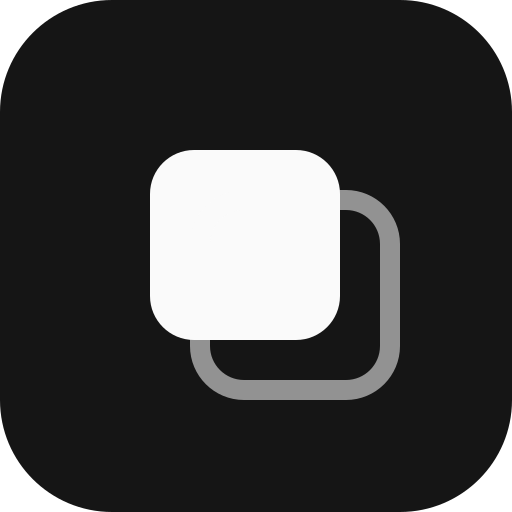

<p align="center">
  
</p>

<h1 align="center">mindblow para Android</h1>

<p align="center">O <a href="https://github.com/mindblow-org/desktop">mindblow</a> no celular, como app: notas no próprio aparelho, sync com os outros, atalhos, widget e "compartilhar".</p>

<p align="center"><a href="https://mindblow-org.github.io/site/">Site</a> · <a href="https://github.com/mindblow-org/android/releases/latest/download/mindblow-android.apk">Baixar o APK</a></p>

> [!NOTE]
> Testado num Moto G24 (Android 14): abrir sem internet, criar notas, ler o QR do PC, as notas irem e voltarem e o que foi escrito sem rede subir quando ela volta, com o app aberto ou fechado. Compartilhar de outro app e o widget ainda não foram testados no aparelho. Veja [Testar no aparelho](#testar-no-aparelho).

O app leva o mindblow inteiro junto: o mesmo servidor do desktop, compilado para Android, roda dentro dele com o banco no próprio celular. A WebView abre a interface que esse servidor entrega, então estilo e comportamento são os do navegador, e tudo funciona sem internet. O que o Android ganha fica em volta:

- **Sync com outros aparelhos** (opcional): toque no QR do canto de cima, em "ler QR", e leia o QR do mindblow do PC (ou cole o link). Daí em diante, o que muda aqui vai para lá e o que muda lá vem para cá, sempre que o outro aparelho responder. Sem rede, as mudanças esperam e sobem sozinhas quando ela volta, mesmo com o app fechado.
- **Compartilhar**: texto e imagens de outros apps viram nota. Texto curto vira sticky; com assunto (o título da página, no navegador), mais de 500 caracteres ou várias imagens, vira texto. As imagens são reduzidas como na web: lado maior de até 2048px, em WebP.
- **Escanear caderno**: o "Escanear caderno" do mindblow abre o scanner de documento do Google, que acha a folha, corta, endireita e aceita até 10 páginas. As páginas viram um board.
- **Atalhos**: segure o ícone para criar uma sticky, um texto, um todo ou um board.
- **Widget**: uma barra na tela inicial com o logo, que abre o app, e um botão para cada tipo de nota.
- **Voltar**: fecha o que estiver aberto (nota, busca, seletor, imagem) antes de sair do app.

Quem já usava o app conectado ao PC não precisa fazer nada: na primeira vez, o link guardado vira o sync com o PC, e as notas de lá descem para o celular.

## Instalar

Baixe o [`mindblow-android.apk`](https://github.com/mindblow-org/android/releases/latest/download/mindblow-android.apk) no celular e abra. O Android pede para liberar a instalação pelo navegador na primeira vez. Precisa de Android 9 ou mais novo. Para sincronizar com o PC pela tailnet, o Tailscale precisa estar ligado no celular.

O leitor de QR é o do Google Play Services, que não pede permissão de câmera. Sem ele, cole o link.

## Como funciona

```
app/src/main/java/app/mindblow/android/
  Node.kt     sobe o servidor (libmindblow.so) com o banco do app
  Main.kt     WebView, tela de erro, voltar, escolher arquivo, scanner de documento, ler QR
  Share.kt    recebe o "compartilhar" e salva no servidor daqui
  Pic.kt      reduz a imagem antes de enviar (igual a web/src/lib/images/shrink.ts)
  Server.kt   chamadas à API do servidor daqui
  Sync.kt     job que sobe o que ficou só aqui quando a rede volta, e o aviso de rede nova
  Widget.kt   barra da tela inicial
```

- `libmindblow.so` é o crate `mobile` do [mindblow](https://github.com/mindblow-org/desktop): o servidor inteiro, com a interface embutida, e uma função JNI só (`Node.start`). O app passa banco, porta e token por variáveis de ambiente (`Os.setenv`), como o serviço do PC. O release (e o beta e o offline) leva só a de arm64, que é a dos celulares: o APK cai de 11 MB para 6 MB. A de x86_64 vai só no debug, para o emulador.
- O servidor escuta em `127.0.0.1:7341`, e o banco fica em `files/mindblow.db`. A porta é fixa porque o `localStorage` da WebView (abas, nome do aparelho) é por endereço.
- `127.0.0.1` é o mesmo para todos os apps do celular, então a API exige um token aleatório, criado na instalação. A WebView entra com ele no `#token=` do link, e o compartilhar usa o mesmo.
- O sync é do servidor: ele puxa e empurra as mudanças de cada link e troca as imagens que faltam. Mudança aqui ou lá acorda o sync; sem resposta, ele tenta de novo com espera crescente.
- Rede voltando: enquanto o processo vive, o `Sync.watch` ouve a rede e chama `POST /api/sync/now`, que reconecta cada link na hora, sem esperar a próxima tentativa. Ao ir para o fundo, o `Main` agenda o job `Sync` (`JobScheduler`, persistido), que o sistema roda quando há rede: ele sobe o servidor se o processo morreu, chama o `now` e espera cada link sincronizar, por até 90 s; se não der, o sistema tenta de novo mais tarde.
- A VPN do Tailscale continua de pé e "validada" no modo avião, só sem transporte embaixo. Por isso o job pede rede com Wi-Fi, celular ou cabo, e aceita a VPN por cima; pedir só "qualquer rede" faria o job rodar à toa no modo avião. Com o Tailscale desligado, o job roda, não alcança o PC e fica para depois.
- A interface pede para ler um QR por `window.mindblowAndroid.scan()`, e o app devolve o link em `window.mindblowLink(url)`. O leitor é o do Google Play Services, que não pede permissão de câmera.
- Quando a página pede câmera (`<input capture>`), o `Main` abre o scanner de documento em vez do seletor de arquivo e devolve as páginas como arquivos. Sem o Google Play Services, cai no seletor.
- Atalhos, widget e compartilhar chegam ao `Main` como extra e viram hash na URL: `#new=<tipo>` cria e abre uma nota, `#open=<id>` abre uma. Quem trata é a interface (`web/src/view/Main.svelte` no mindblow).
- O botão voltar chama `window.mindblowBack()`, que faz o papel do Esc e responde se havia algo para fechar. Se não havia, o app vai para segundo plano.
- O app se apresenta com `mindblow-android/<versão>` no user agent, e a lista de dispositivos mostra "App Android".
- Do Android 11 em diante, o app desenha por baixo das barras do sistema e põe o recuo à mão, contando o teclado.
- Sem AndroidX nem Compose: `Activity`, `WebView` e `HttpURLConnection` do próprio Android. As dependências Java são o leitor de QR e o scanner de documento, os dois do Google Play Services (o trabalho pesado mora no Play Services, não no APK). O que pesa no APK é a `libmindblow.so`, uma por ABI.

## Desenvolver

Precisa do JDK 17, do Android SDK (35) com o NDK 27.1.12297006, do Rust com as targets do Android, do [`cargo-ndk`](https://github.com/bbqsrc/cargo-ndk) e do pnpm, e do repo do [mindblow](https://github.com/mindblow-org/desktop) ao lado (`../mindblow.app`) ou em `MINDBLOW_SRC`:

```sh
rustup target add aarch64-linux-android x86_64-linux-android
cargo install cargo-ndk

./gradlew assembleDebug                 # compila a interface, a libmindblow.so e o APK
./gradlew installDebug                  # instala no aparelho ou emulador ligado
./gradlew lintDebug
MINDBLOW_SKIP_NODE=1 ./gradlew assembleDebug   # só o Kotlin, sem o servidor (o APK não abre)
```

No emulador, use o debug (`./gradlew installDebug`), o único com o servidor para x86_64. Lá, o PC é `10.0.2.2`. Para sincronizar com um mindblow rodando nele, suba o servidor com `MINDBLOW_HOSTS=10.0.2.2` e ligue o link `http://10.0.2.2:7341` no app.

## Testar no aparelho

Com o celular plugado (`adb devices`) e o mindblow com sync rodando no PC:

1. `./gradlew installDebug` e abra pelo ícone. Com o modo avião ligado, o app abre direto nas notas, sem tela de conectar.
2. Crie uma nota de cada tipo, com imagem, ainda sem rede. Feche e abra: elas continuam lá.
3. Desligue o modo avião, ligue o Tailscale, toque no QR, em "ler QR", e leia o QR do mindblow do PC. O link aparece "em dia" e as notas vão para o PC (com as imagens).
4. Edite a mesma nota no PC e no celular, uma em cada campo, e confira que as duas edições ficam nos dois lados. Exclua uma no PC e veja ela sumir do celular.
5. Ligue o modo avião, escreva uma nota, vá para a tela inicial e abra outros dois apps (para o processo do mindblow ir para o cache). `adb shell am kill <pacote>` e confira com `pidof` que ele morreu. Desligue o modo avião: a nota chega no PC em segundos sem abrir o app, e `dumpsys jobscheduler` mostra o `Sync` rodando e terminando.
6. Compartilhe um texto e uma foto de outro app, use os atalhos do ícone e o widget, com e sem rede.
7. Quem já tinha o app conectado ao PC: instale por cima (`adb install -r`) e veja o link antigo virar o sync, com as notas descendo.

Em aparelho MediaTek (como o Moto G24), não abra o app com `am start` logo depois de um `am force-stop`: o DuraSpeed deixa a WebView em branco. Abra pelo ícone. O `force-stop` também cancela o job do sync; para testar com o app morto, use `am kill`.

## Release

Cada push na branch `release` dispara o workflow [release](.github/workflows/release.yml), que compila o APK assinado e publica a release `vX.Y.Z` com o `mindblow-android.apk`. A versão vem de `version` no `gradle.properties` (o `versionCode` sai dela: `1.2.3` vira `10203`). Para soltar uma versão nova:

```sh
# suba a versão no gradle.properties e commite na main
git push origin main:release
```

Se a versão já foi publicada, o workflow para e avisa. A assinatura usa quatro secrets do repositório:

| Secret | |
|---|---|
| `ANDROID_KEYSTORE` | o `.jks` em base64 (`base64 -w0 release.jks`) |
| `ANDROID_KEYSTORE_PASSWORD` | senha do keystore |
| `ANDROID_KEY_ALIAS` | alias da chave |
| `ANDROID_KEY_PASSWORD` | senha da chave |

Guarde o keystore fora do repositório: sem ele, um APK novo não instala por cima do antigo. Localmente, sem `MINDBLOW_KEYSTORE`, o `assembleRelease` assina com a chave de debug, só para testar.

### Versão de teste

Cada push numa branch de trabalho (qualquer uma menos `main` e `release`) dispara o workflow [teste](.github/workflows/teste.yml). Ele compila o build `beta` e troca a pré-release única [`teste`](https://github.com/mindblow-org/android/releases/tag/teste) pelo APK novo, `mindblow-android-teste.apk`. Ela nunca vira "latest", então o link de download do README continua apontando para a release de verdade.

O `beta` é o release com outro pacote (`app.mindblow.android.teste`) e outro nome (**mindblow teste**): instala ao lado do app normal, com link e token próprios, e fica sem atalhos. Dá para apontar ele para um servidor de teste e deixar o app de todo dia no servidor de verdade.

```sh
./gradlew assembleBeta                  # app/build/outputs/apk/beta/app-beta.apk
```

## Licença

[MIT](LICENSE)
